# Architecture

How itinera-rs is put together, and how it runs a journey, drawn tier by tier. Each tier adds a section once it is built, so this document never describes anything ahead of the code.

Every diagram is followed by a numbered list that says everything it shows, and by the places in the code where that part lives. The words are those of the [specification](https://github.com/itinera-dev/spec), chapter 1, and the Rust names are those of the code. Why each part is shaped the way it is, is decided in the [tier 1 plan](tier-1-plan.md).

## Tier 1

Tier 1 runs a journey in one process, synchronously or asynchronously, with steps, retries, rescue steps, policies and their hooks, roles, input adapters, services, events and reporters.

### The crates

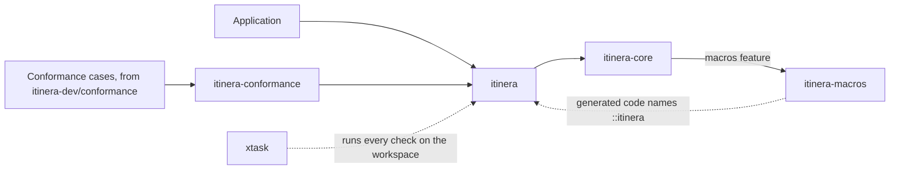

1. An application depends on one crate, `itinera`.
2. `itinera` re-exports every module of `itinera-core`, where the whole implementation lives.
3. With the `macros` feature, on by default, `itinera-core` depends on `itinera-macros` and re-exports each macro from the module of its concept, so an application writes `itinera::step::step`.
4. The code the macros generate names `::itinera`, so it reaches the core through the same paths an application writes.
5. `itinera-conformance`, which is not published, depends on `itinera` and runs the conformance cases of [itinera-dev/conformance](https://github.com/itinera-dev/conformance) against it.
6. `xtask`, which is not published either, runs every required check on the workspace with `cargo xtask check`.

The features are `macros` (on by default), `async`, which adds the asynchronous executor and the asynchronous traits, `testing`, which adds `RecordingReporter` and the recorders that lend a test the handles of steps, hooks and input adapters, and `unstable`, which holds API the specification has not settled yet.

`itinera-core` has one public module per concept, and one private module, `engine`:

| Module | Holds |
|---|---|
| `value` | `AnyValue`, the type-erased value of the data bag, event data and reasons' details |
| `journey` | The data bag, journey IDs, contributors, the result, failures and aborts; with `testing`, `Contributions` |
| `step` | Step names, needs and their tokens, factories, steps, outcomes, reasons, attempts, step reporters, rescue steps; with `testing`, `StepEventReporter` |
| `policy` | Policy descriptors, the hook traits, hook needs, what a hook receives, hook reporters, lifecycles, roles; with `testing`, `HookEventReporter` |
| `workflow` | Workflow descriptors, their builder, the `Workflow` trait, input adapters, violations, the listing |
| `service` | Service tokens and service providers, of journey or attempt scope |
| `instance` | The `WorkflowInstance` trait, `Instance` and its builder |
| `executor` | `LocalExecutor`, `AsyncLocalExecutor` and refusals |
| `event` | `Event`, its bodies, who did or decided what, and the `Level` of the events steps and hooks emit; with `testing`, `Emitted` |
| `report` | Reporters, dispatchers and their factories, `DefaultDispatcher`, `GlobalMetadata` |
| `mode` | `Synchronous` and `Asynchronous` |
| `error` | `Error` and `Interrupted` |
| `engine` | Private: the one engine both executors share |

Where it lives: `crates/`, and each module in `crates/itinera-core/src/`.

### What a workflow is made of

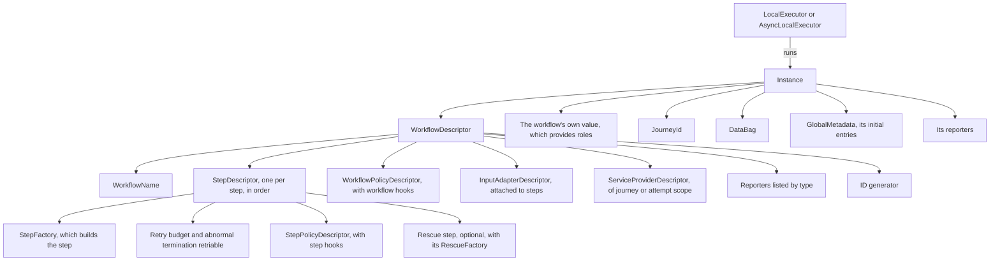

1. A `WorkflowDescriptor` is the workflow's declaration. It is immutable, shared by every instance, and only `build()` makes one.
2. It holds the workflow's name, its step descriptors in the order they run, its workflow policies, its input adapters, its service providers, the reporters it lists by type, and its ID generator.
3. Each `StepDescriptor` holds the factory that builds the step for each attempt, its retry budget, whether an abnormal termination is retriable, its step policies in the order attached, and, optionally, a rescue step with its own factory.
4. Each policy descriptor names the hooks it defines; a step policy holds step hooks and a workflow policy holds workflow hooks.
5. An input adapter is attached to whole steps, at most one per step. A service provider is attached to steps, or to no step, and is of journey or attempt scope.
6. An `Instance` holds the descriptor, the workflow's own value, the journey ID, the data bag, the initial global metadata the reporters will receive, and the reporters made for this journey. The workflow's own value is the type `W` every part is generic over, and it provides the workflow's roles.
7. An executor runs an instance. It relies only on the `WorkflowInstance` trait, so it runs any instance, however it was made.

Where it lives: `workflow/builder.rs`, `step/descriptor.rs`, `policy/descriptor/`, `workflow/input_adapter.rs`, `service/descriptor.rs`, `instance.rs`, `instance/workflow_instance.rs`, `instance/committed.rs`.

### How the macros go into the mix

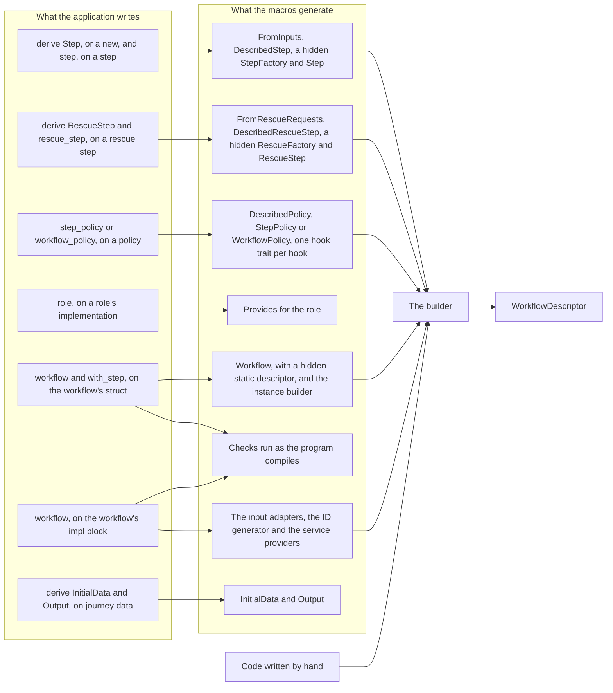

1. The macros are syntax over the builder. Each one expands to implementations of public traits of the core and to builder calls, which an application could write by hand, so nothing is reachable only through the macros.
2. `#[derive(Step)]` on a step's struct, or a `new` in the `#[step]` block whose parameters are marked `#[input]`, gives `FromInputs`: what the step needs, one input per field not marked `#[default]` or per parameter of `new`, and how the step is built from them. `new` may also take services, and may return a `Result` whose error means the step could not be built. A step uses one or the other, never both.
3. `#[step]` on the step's `impl` block gives `DescribedStep`, with a hidden factory implementing `StepFactory` and a hidden step implementing `Step`, or their asynchronous traits when `run` is `async`. The hidden step keeps the handles and services `run` asks for, and calls it with them.
4. `#[derive(RescueStep)]` and `#[rescue_step]` do the same for a rescue step, with `FromRescueRequests`, `DescribedRescueStep`, `RescueFactory` and `RescueStep`.
5. `#[step_policy]` and `#[workflow_policy]` give `DescribedPolicy`, `StepPolicy<W>` or `WorkflowPolicy<W>`, and one hook trait per hook, such as `OnStepSuccess<W>`, whose needs come from the hook's parameters.
6. `#[role]` keeps the role's implementation and gives `Provides<dyn Role>`, so a policy asking for that role can be attached to this workflow, and to no workflow that does not provide it.
7. `#[workflow]` on the workflow's struct, with one `#[with_step]` line per step, gives the `Workflow` trait. Its arguments name the workflow, its workflow policies and its reporters, and each `#[with_step]` line names a step's type and name, its retry budget, whether an abnormal termination is retriable, its step policies and its rescue step. Its `descriptor()` builds the descriptor with the builder the first time it is asked for, and keeps it in a hidden static. It also gives the instance builder, `Orders::builder()`, with one setter per field.
8. `#[workflow]` on the workflow's `impl` block gives the input adapters, the ID generator and the service providers, which the struct's descriptor adds to its builder.
9. Both `#[workflow]` macros generate checks that run as the program compiles, such as an input adapter or a service provider for a step the workflow does not list, so nearly every violation `build()` would report is a compile error pointing at what was written.
10. `#[derive(InitialData)]` and `#[derive(Output)]` give the traits that write a struct into the initial data and read it back from the result.
11. Everything goes through the builder to a `WorkflowDescriptor`, exactly as code written by hand does. From there on, the engine cannot tell how the workflow was declared.

This is what one step declared with the macros becomes, once when it is declared and then for each of its attempts:

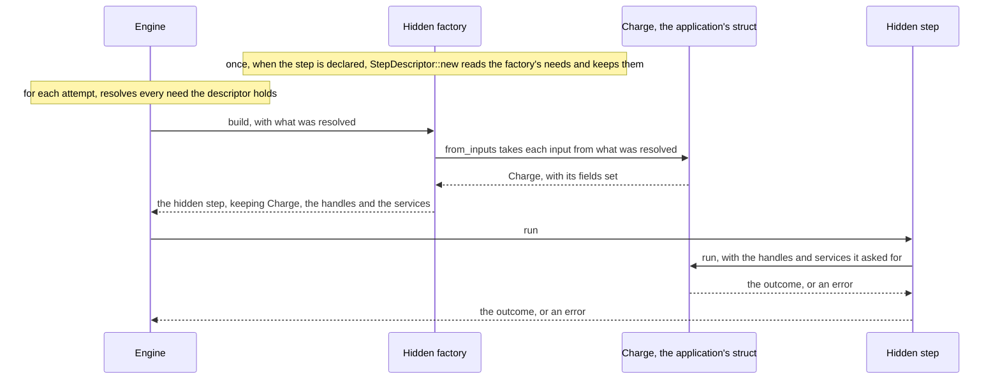

1. When the workflow is declared, `StepDescriptor::new` asks the hidden factory once what the step needs: one input per field not marked `#[default]`, or per parameter of `new`, and the contributor, reporter and services that `run` asks for. The descriptor keeps them.
2. For each attempt, the engine resolves every need the descriptor holds, as "Parameter injection" below shows.
3. The engine calls the factory's `build` with what it resolved. The factory calls `from_inputs`, which takes each input and sets the struct's fields.
4. The factory returns the hidden step to the engine. The hidden step keeps the struct, the handles and the services.
5. The engine runs the hidden step, which calls the application's `run` with the handles and services it asked for.
6. The outcome, or the error, goes back through the hidden step to the engine.

Where it lives: `crates/itinera-macros/src/`, with `step.rs`, `policy.rs`, `role.rs` and `workflow.rs`; the traits they implement are in `step/described.rs`, `step/factory.rs`, `step/from_inputs.rs`, `step/rescue/described.rs`, `step/rescue/factory.rs`, `step/rescue/from_requests.rs`, `policy/described.rs`, `policy/role.rs`, `workflow/described.rs`, `journey/initial_data.rs` and `journey/output.rs` of `itinera-core`.

### From declaration to result

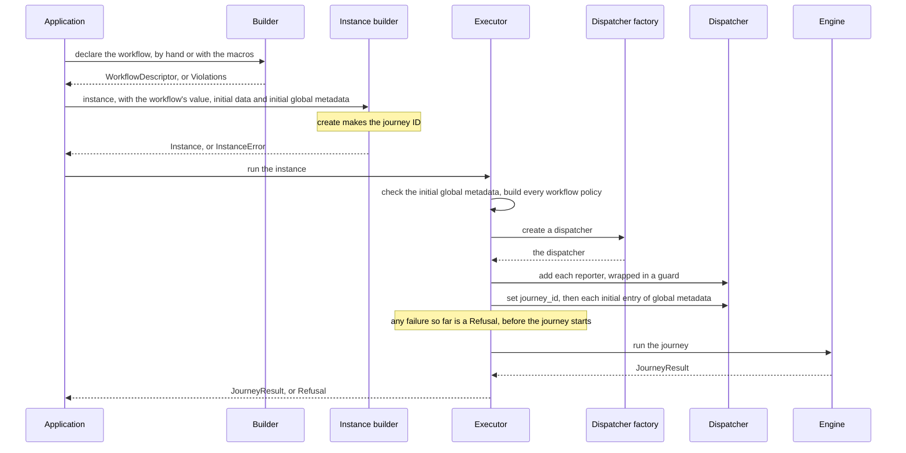

1. The application declares the workflow, with the builder or the macros. `build()` checks what types cannot, and returns the descriptor or every `Violations` at once.
2. The application makes an instance with the workflow's own value, the initial data and, if it wants, initial global metadata. `create()` makes the journey ID, with the workflow's ID generator or a UUID version 4. A failure there is an `InstanceError`.
3. The application gives the instance to an executor's `run`.
4. The executor takes the instance's initial global metadata, which may not set `journey_id`, and builds every workflow policy, once for this journey.
5. It asks its dispatcher factory for a new dispatcher, and adds each of the instance's reporters to it, wrapped in a guard (see "Events and delivery").
6. Through the dispatcher, it sets the journey ID under `journey_id`, then each entry of the initial global metadata, in the order its keys were first set. Neither emits an event.
7. A failure in any of these is a `Refusal`, and the journey never starts.
8. The executor hands the instance, the policies and the dispatcher to the engine, which runs the journey.
9. The executor returns the `JourneyResult`.

Both executors share the one engine, which is written once, as asynchronous code. `LocalExecutor` drives it to the end with a waker that does nothing, since a `Synchronous` workflow has nothing to wait for. `AsyncLocalExecutor` awaits it, and its dispatcher's delivery, on whatever runtime the application uses. The engine never spawns, sleeps or sets timers.

Where it lives: `workflow/builder.rs`, `instance/builder.rs`, `executor.rs`, `executor/refusal.rs`, `executor/asynchronous.rs`, `run` and `finish` in `engine.rs`, and `introduce` in `engine/metadata.rs`.

### The executor loop

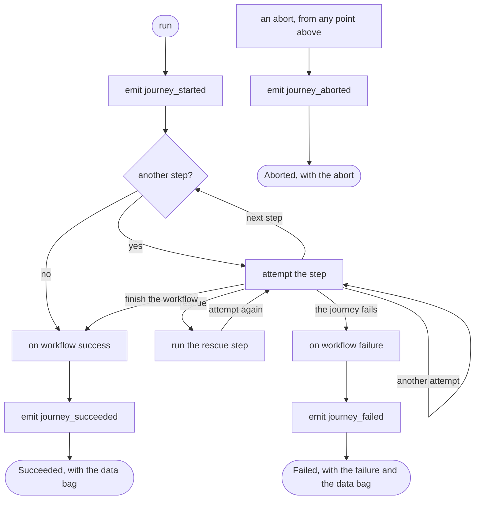

1. The engine emits `journey_started`, with the keys of the initial data.
2. It scans the steps: it takes each one in the order the workflow lists them, and attempts it (see "One attempt").
3. Each attempt ends in one of five ways on: the next step, another attempt of the same step, its rescue step, finishing the workflow early, or the journey failing.
4. After a rescue step runs, the rescued step is attempted again.
5. When there is no step left, or an `on step success` hook finished the workflow, the engine calls the `on workflow success` hook, if a workflow policy defines it, and emits `journey_succeeded`, naming the policy that finished the workflow, if one did. The result is `Succeeded`, with the data bag.
6. When the journey fails, because a step was given up or a hook returned `FailWorkflow`, the engine calls the `on workflow failure` hook, if a workflow policy defines it, and emits `journey_failed`. The result is `Failed`, with the failure and the data bag.
7. An abort can come from any point of the journey, including the workflow hooks. The engine emits `journey_aborted` and the result is `Aborted`, which carries no data bag. Workflow hooks are not called for an abort.

Where it lives: `travel`, `scan` and `run_step` in `engine.rs`, four of the five ways on as `Next` there and the journey failing as `End::Failed` in `engine/end.rs`, and `engine/hooks/workflow.rs`.

### One attempt

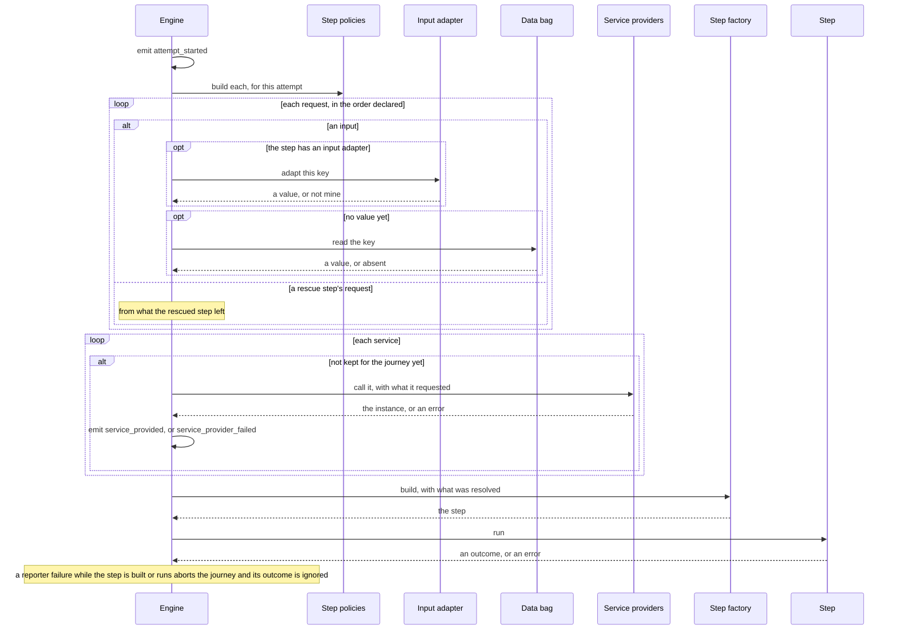

1. The engine emits `attempt_started`, naming the step and the attempt number, from 1.
2. It builds the step's policies, new for every attempt. A policy that cannot be built aborts the journey with `policy could not be built`.
3. It resolves the step's requests in the order they were declared, as "Parameter injection" shows. An input goes first to the step's input adapter, if it has one, and then, if the adapter has no value for it, to the data bag. A rescue step's request for the rescued step's data, reason or error is answered from what the rescued step left.
4. It provides each service the step asks for. A provider of attempt scope is called for this attempt. One of journey scope is called at the first request only, and its instance is kept until the journey ends. Each call first resolves what the provider requested, then emits `service_provided`, or `service_provider_failed` before the journey aborts with `step could not be built`.
5. It builds the step with the factory, handing it what it resolved, and a contributor and a reporter if the step asked for them. An error from the factory, an input adapter or a provider aborts the journey with `step could not be built`.
6. It runs the step, which returns an outcome, or an error, which is an abnormal termination.
7. If a reporter failed while the step was built or ran, the journey is already aborted: the step's outcome is ignored.
8. Otherwise the contributions the step made are kept for this attempt's hooks when it returned an outcome, and dropped when it returned an error, and the engine goes on to "Outcomes".

Where it lives: `engine/attempt.rs`, `engine/attempt/policies.rs`, `engine/inputs.rs`, `engine/services.rs`, and the factories in `step/factory.rs`.

### Parameter injection

Every step, rescue step, hook, input adapter and service provider declares what it needs, and the engine hands it exactly that. With the builder, each need is a typed token, such as `const AMOUNT: Input<i64> = Input::new("amount")`, listed in `needs()` and taken back, already of its type, with `got.input(&AMOUNT)?`. With the macros, each field or annotated parameter is one need, and the macro writes the tokens and the calls.

This is how one requested key gets its value:

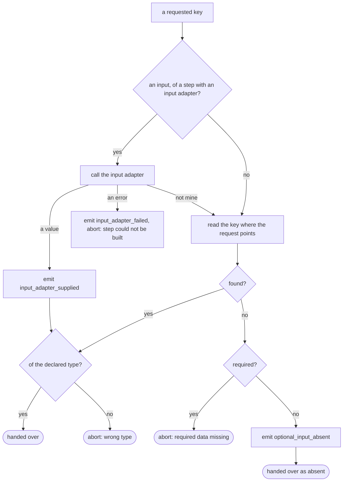

1. For an input of a step or rescue step that has an input adapter, the engine calls the adapter first, with what the adapter itself requested.
2. An adapter that has a value emits `input_adapter_supplied`, and the value is checked against the step's declared type.
3. An adapter that says "not mine" leaves the key to be read as if there were no adapter.
4. An adapter that fails emits `input_adapter_failed`, and the journey aborts with `step could not be built`.
5. Otherwise the key is read where the request points: the data bag for an input or data from the workflow, the attempt's contributions for data from the step, or the rescued step's contributions for a rescue step.
6. A value of the declared type is handed over. Any other type aborts the journey with `wrong type`, including `i32` where `i64` was declared.
7. A missing value aborts the journey with `required data missing` when the request is required. When it is optional, the engine emits `optional_input_absent` and hands over `None`.
8. Requests are resolved in the order declared, so the first required one without a value aborts the journey before anything after it is resolved, and before the requester runs.

What each requester may ask for, and where it comes from:

| Requester | May request | Each comes from |
|---|---|---|
| Step | inputs, services, a contributor, a reporter | inputs from its input adapter, then the data bag; services from their providers; handles made for the attempt |
| Rescue step | inputs, data from the rescued step, the reason, the error, services, a contributor, a reporter | inputs from its own input adapter, then the data bag; what the rescued step's attempt left; services from providers attached to the rescue step's name or to no step |
| Step hook | data from the step, data from the workflow, the step's name, the attempt, the reason, the cause, the error, the journey ID, roles, a contributor, a reporter | the attempt's contributions; the data bag; the attempt; the attempt's failure, by hook; the workflow's own value, for roles |
| Workflow hook | data from the workflow, the journey ID, roles, a contributor, a reporter | the data bag; the workflow's own value, for roles |
| Input adapter | the step's name, the key, data from the workflow, the journey ID, read access to the data bag, and always the workflow's own value | the attempt and the key being adapted; the data bag; the workflow instance |
| Service provider | data from the workflow, the journey ID, a reporter, and, of attempt scope only, the step's name and the attempt, and always the workflow's own value | the data bag; the attempt being provided; the workflow instance |

A request a requester may not make does not compile. Roles come from the workflow's own value through `Provides<dyn Role>`, so a role it does not provide does not compile either. Received data is each receiver's own copy, never a reference into the data bag, and a contributor or reporter cannot outlive its attempt or hook.

In a test, behind the `testing` feature, the handles can come from recorders instead of the engine: `Contributions` lends a contributor, `StepEventReporter` and `HookEventReporter` lend reporters, and a `DataBag` built from values lends read access. A test then calls `run`, a hook or an input adapter itself, with plain values for everything else, and reads back what was contributed and emitted. A reporter lent this way emits into its recorder through the same `Reporting` the engine's reporters use.

Where it lives: `engine/inputs.rs`, `engine/request.rs`, `engine/services.rs`, `answer` in `engine/hooks.rs`, a hook's reason and error in `engine/hooks/step/left.rs`, `rescue_request` in `engine/rescue.rs`; what each requester may request in `policy/kind/`; the tokens and needs in `step/input.rs`, `step/needs.rs`, `policy/needs/` and `service/token.rs`; the recorders in `journey/contributions.rs`, `step/event_reporter.rs`, `policy/event_reporter.rs` and `event/emitted.rs`, and `DataBag::with` in `journey/data_bag.rs`.

### Outcomes

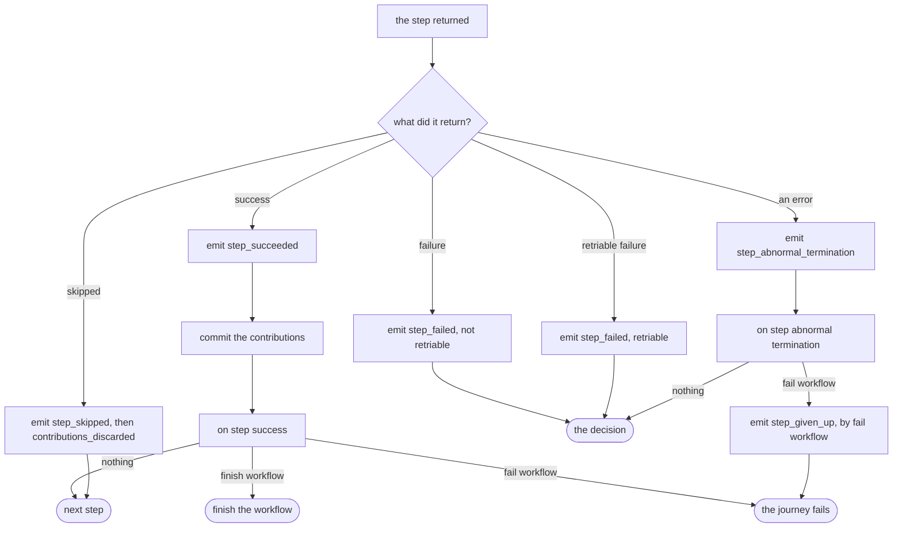

1. A success emits `step_succeeded`, then commits the attempt's contributions to the data bag, emitting `contribution_committed` for each key, and `data_overwritten` when the key already held a value.
2. Then the engine calls `on step success`, if one of the step's policies defines it. Returning nothing goes on to the next step. `FinishWorkflow` finishes the workflow without running the steps left. `FailWorkflow` fails the journey, with the hook's reason.
3. A skip emits `step_skipped`, then `contributions_discarded`, and goes on to the next step.
4. A failure emits `step_failed`, not retriable, and a retriable failure emits `step_failed`, retriable. Both go to the decision.
5. An error emits `step_abnormal_termination`, then calls `on step abnormal termination`, if defined. `FailWorkflow` gives the step up, emitting `step_given_up` with that hook as its cause, and fails the journey. Returning nothing goes to the decision.

Where it lives: `engine/outcome.rs`, and the step hooks in `engine/hooks/step.rs`.

### The decision

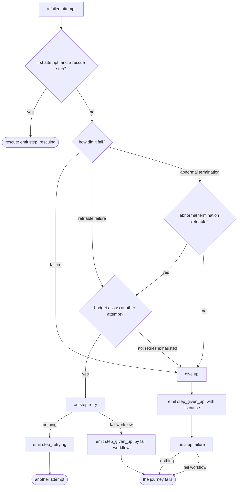

1. When the first attempt of a step with a rescue step fails, in any way, the step is rescued (see "Rescue").
2. Otherwise, a failure gives the step up.
3. A retriable failure is retried while the retry budget allows another attempt, and gives the step up, with retries exhausted, once it does not.
4. An abnormal termination is retried in the same way only when the step declares it retriable; otherwise it gives the step up.
5. Before a retry, the engine calls `on step retry`, if defined. `FailWorkflow` gives the step up, emitting `step_given_up` with that hook as its cause, and fails the journey. Returning nothing emits `step_retrying`, and the step is attempted again, built anew.
6. Giving up emits `step_given_up`, with its cause: failure, abnormal termination or retries exhausted. Then the engine calls `on step failure`, if defined.
7. The journey fails either way: with the failure, the abnormal termination or the retries exhausted, or, when `on step failure` returns `FailWorkflow`, with the hook's reason.

Where it lives: `decide` in `engine/decision.rs`, and `engine/retry.rs`.

### Rescue

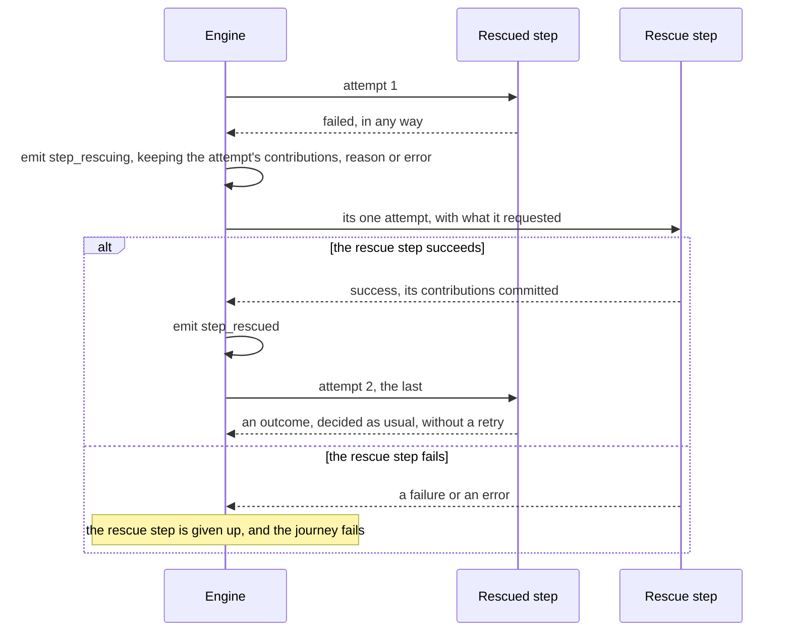

1. The rescued step's first attempt fails, in any way.
2. The engine emits `step_rescuing`, with how it failed, and keeps what the attempt left: its contributions, which were not committed, and its reason or its error.
3. The rescue step, named after the step with `_rescue` added, has one attempt, like any step's, starting with `attempt_started`. It may request inputs, the rescued step's contributions, its reason and its error, and services from providers attached to its own name or to no step.
4. When it succeeds, its contributions are committed, the engine emits `step_rescued`, and attempts the rescued step a second time.
5. That second attempt is the last: a rescued step has no retry budget, so a failure there gives it up.
6. A rescue step has no policies, no retry budget and no rescue step of its own, so when it fails it is given up and the journey fails.

Where it lives: `engine/rescue.rs`, and the rescue steps' own types in `step/rescue/`.

### Policies and hooks

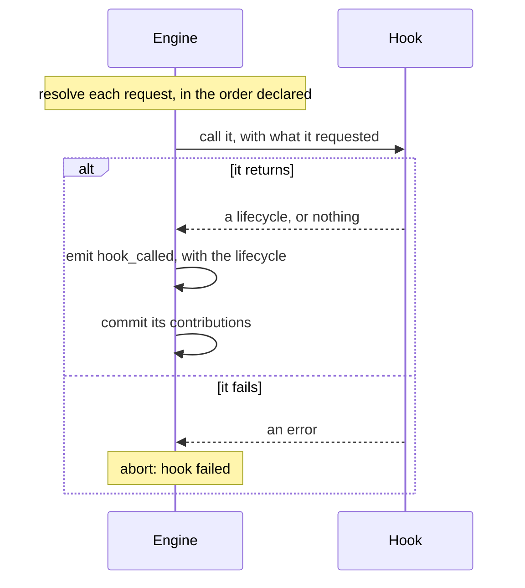

1. Before calling a hook, the engine resolves its requests in the order declared, as "Parameter injection" shows. A step hook resolves data from the step from the attempt's contributions.
2. It calls the hook, which takes `&self`: everything it needs arrives as parameters.
3. A hook returns its own type, holding only the lifecycles it may return. The engine emits `hook_called`, with that lifecycle, and commits the hook's contributions.
4. A hook that returns an error, including one from a role it uses, aborts the journey with `hook failed`. If a reporter failed while the hook was emitting, the journey is already aborted and what the hook returned is ignored.

When each hook is called, and what it may return:

| Hook | Called | May return |
|---|---|---|
| `on step success` | after a success, once its contributions are committed | nothing, `FinishWorkflow` or `FailWorkflow` |
| `on step retry` | before a retry | nothing or `FailWorkflow` |
| `on step abnormal termination` | after an error, before the decision | nothing or `FailWorkflow` |
| `on step failure` | after the step's own rule gives it up, not when another hook's `FailWorkflow` gave it up | nothing or `FailWorkflow` |
| `on workflow success` | after the last step, or after `FinishWorkflow` | nothing |
| `on workflow failure` | after the journey fails | nothing |

A hook is defined by at most one policy of a step, or of the workflow; `build()` refuses a hook defined twice. Workflow policies are built once per journey, before it starts, where a failure is a refusal. Step policies are built anew for every attempt, where a failure aborts the journey.

Where it lives: `call_hook` in `engine/hooks.rs`, `engine/hooks/step.rs`, `engine/hooks/workflow.rs`, and the hook traits in `policy/`.

### Events and delivery

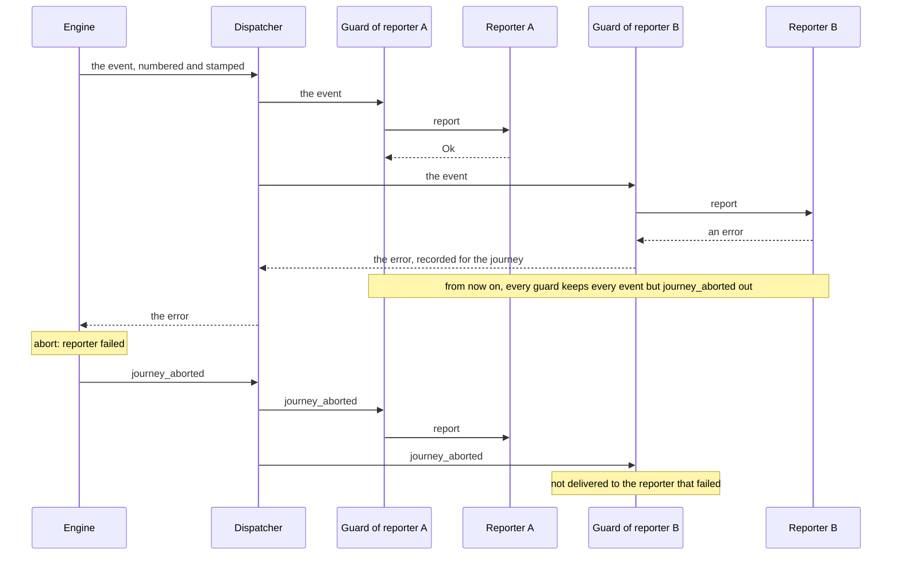

1. The engine gives each event the next sequence number, from 1, and a timestamp, and hands it to the journey's dispatcher.
2. The dispatcher calls each reporter through the guard the executor wrapped it in. `DefaultDispatcher` calls them in the order they were added; a dispatcher of the application's own may order them as it chooses.
3. When a reporter returns an error, its guard records the failure for the journey. From then on every guard keeps every event except `journey_aborted` out of its reporter, so the reporters after it never receive that event, whatever the dispatcher does. `DefaultDispatcher` also stops delivering it at once.
4. The engine sees the failure, recorded by a guard or returned by the dispatcher itself, and aborts the journey with `reporter failed`.
5. `journey_aborted` goes to every reporter except the one that failed: its guard keeps it out. An error while `journey_aborted` itself is delivered is ignored.
6. Steps and hooks emit through the handles they asked for: a `StepReporter` emits `step_info`, `step_warning` and `step_error`, and the reporter of a hook or a service provider emits `journey_info`, `journey_warning` and `journey_error`. Delivery finishes before the call returns.
7. When a reporter fails during such a delivery, the call returns `Interrupted`, and nothing the step, hook or provider emits afterwards is delivered. When it returns, what it returned is ignored, and the journey ends aborted.
8. The same handles set entries of the journey's global metadata with `set_global_metadata`. The engine passes the entry to the dispatcher, which passes it to every reporter through its guard, as it does an event, then emits `global_metadata_set`, which names the key and who set it, never the value. A reporter that fails on an entry fails the journey exactly as on an event. A key of `journey_id` reaches no reporter, and aborts the journey with `reserved metadata key`. Either way the call returns `Interrupted`.
9. An entry stands from the moment it is set: no later outcome, retry or abort takes it back. Each reporter decides what to keep; `GlobalMetadata` keeps the latest value of each key, for a reporter that wants it.

Events carry no format: reporters write them as they choose. The synchronous executor delivers inline; the asynchronous one awaits the dispatcher, whose reporters may be of either kind.

Where it lives: `engine/emitter.rs`, `engine/metadata.rs`, `engine/guard.rs`, `engine/asynchronous.rs`, `report/`, `step/reporting.rs`, and the events in `event/`.

### How a journey ends

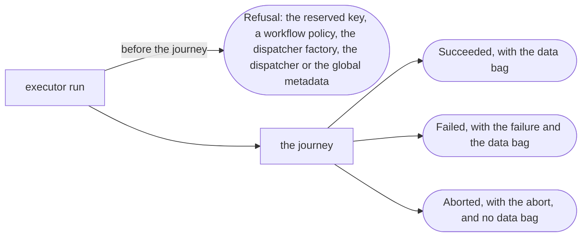

1. Before the journey starts, the executor refuses it when the initial global metadata sets `journey_id`, a workflow policy cannot be built, the dispatcher factory fails, the dispatcher fails while the reporters are added, or a reporter or the dispatcher fails while the journey ID or the initial global metadata is set. No event is emitted.
2. A journey that started ends in one of three statuses, each carrying only what it may: `Succeeded`, with the data bag; `Failed`, with the failure and the data bag; or `Aborted`, with the abort and no data bag.

A failure has one variant per cause:

| Failure | Comes from |
|---|---|
| `Failure` | a step was given up after a failure, with its reason |
| `RetriesExhausted` | a step was given up when its budget allowed no more attempts, with what ended its last attempt |
| `AbnormalTermination` | a step was given up after an error it does not retry |
| `FailWorkflow` | a hook returned `FailWorkflow`, with its reason |

An abort has one variant per reason:

| Abort | Comes from |
|---|---|
| `StepCouldNotBeBuilt` | the step's factory, its input adapter or a service provider failed, or no provider serves a service |
| `PolicyCouldNotBeBuilt` | a step policy's factory failed, for an attempt |
| `RequiredDataMissing` | a required request had no value, or a required reason or error did not exist |
| `WrongType` | a value was of another type than declared |
| `HookFailed` | a hook returned an error |
| `ReporterFailed` | a reporter, or the dispatcher, returned an error |
| `ReservedMetadataKey` | a step, hook or service provider set the global metadata `journey_id` |

The result holds the error itself, where events carry only its message. Step statuses and attempt counts are not in the result: they are in the event stream.

Where it lives: `engine/end.rs`, `journey/result.rs`, `journey/abort.rs` and `journey/abort/`, and `executor/refusal.rs`.
